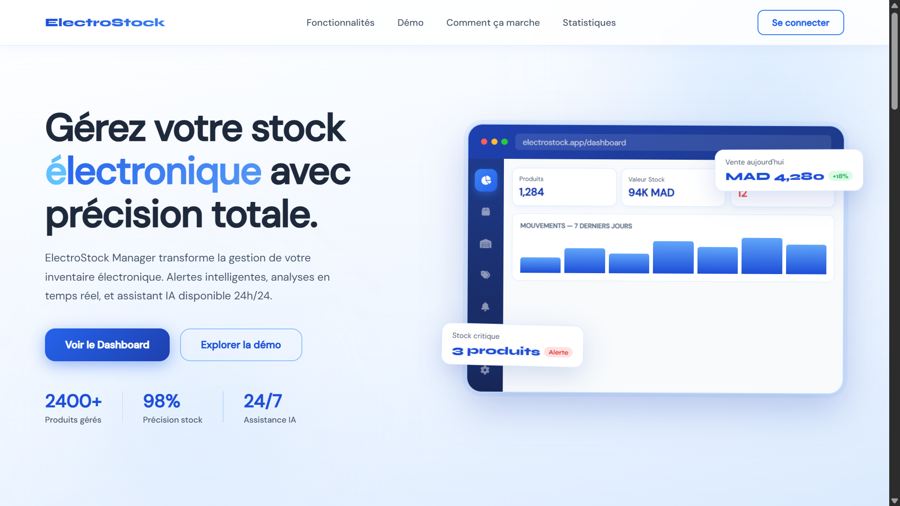
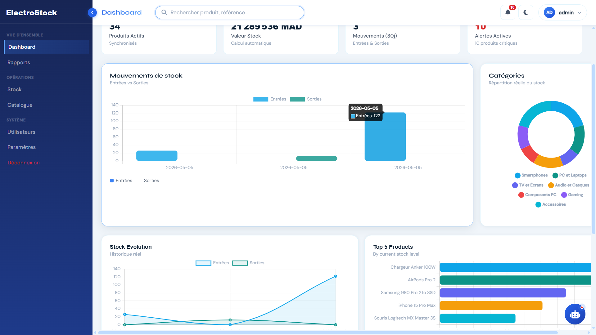
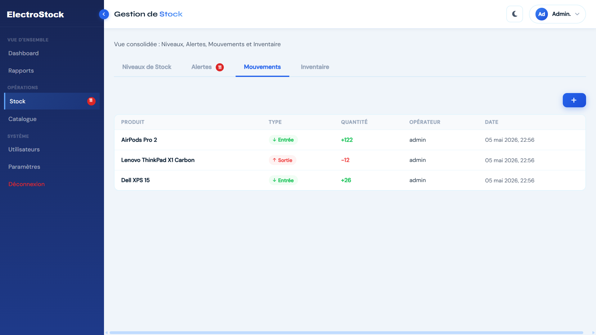
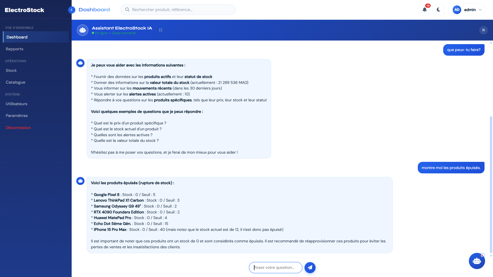
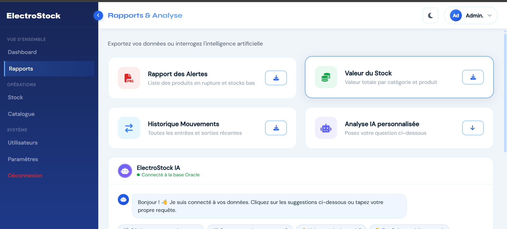

# ElectroStock Manager

<p align="center">

  

</p>

<p align="center">

<strong>Application web complète de gestion de stock pour entreprises de matériel électronique</strong><br/>

JavaScript · Node.js · Express · Oracle XE · Chart.js · OpenAI GPT-OSS-20B

</p>

<p align="center">

  

  

  

  

  

  

</p>

---

## 📌 À propos

**ElectroStock Manager** est une application web complète destinée à la gestion de stock des entreprises spécialisées dans le matériel électronique.

Le système permet de gérer les produits, catégories, fournisseurs, mouvements de stock, inventaires et utilisateurs, tout en fournissant un tableau de bord avec des indicateurs et graphiques en temps réel.

Une fonctionnalité d'**assistant IA** permet également d'analyser les données du stock et de répondre aux questions de l'utilisateur à partir des données disponibles dans le système.

Le projet est composé d'un **frontend web**, d'une **API REST backend** et d'une **base de données Oracle XE**.

> Filière : mathématiques et Informatique — 2025/2026

---

## 🚀 Parcours utilisateur

```text
                    Page d'accueil
                          │
                          ▼
                 Connexion / Inscription
                          │
                          ▼
                   Dashboard principal
                          │
          ┌───────────────┼────────────────┐
          ▼               ▼                ▼
        Stock          Catalogue         Rapports
          │               │                │
          └───────────────┼────────────────┘
                          ▼
                    Assistant IA
                          │
                          ▼
                    Oracle Database
```

---

# 🖥️ Aperçu de l'application

## Page d'accueil

<p align="center">

  

</p>

## Dashboard — KPIs & graphiques

<p align="center">

  

</p>

## Gestion du stock — Mouvements

<p align="center">

  

</p>

## Assistant IA

<p align="center">

  

</p>

## Rapports & analyse

<p align="center">

  

</p>

---

# ✨ Fonctionnalités

## 📊 Dashboard temps réel

* 4 KPIs principaux :

  * Produits actifs
  * Valeur totale du stock en MAD
  * Mouvements des 30 derniers jours
  * Alertes actives
* Graphiques interactifs avec **Chart.js**
* Évolution des entrées et sorties
* Répartition des produits par catégorie
* Évolution du stock
* Top 5 des produits
* Recherche globale des produits et références

---

## 📦 Gestion du stock

Vue centralisée permettant de gérer :

* Niveaux de stock
* Alertes
* Mouvements
* Inventaire

Statuts visuels :

* 🟢 **En stock**
* 🟠 **Stock bas**
* 🔴 **Rupture**

Les alertes sont également visibles directement dans l'interface.

---

## 🛒 Catalogue

Gestion complète des produits :

* Ajouter un produit
* Modifier un produit
* Supprimer un produit
* Consulter les produits
* Gestion des catégories
* Gestion des fournisseurs
* Références produits
* Prix et quantités
* Informations de stock

---

## 📋 Mouvements de stock

Gestion des opérations :

* Entrées
* Sorties
* Ajustements
* Historique des mouvements
* Quantités
* Dates
* Produits concernés

---

## 📦 Inventaire

Le module d'inventaire permet de :

* Consulter les stocks
* Vérifier les quantités
* Effectuer des contrôles
* Suivre les écarts
* Mettre à jour les informations de stock

---

## 📈 Rapports & analyse

Le système propose différents rapports :

* Rapport des alertes
* Valeur du stock par catégorie
* Historique des mouvements
* Analyse des produits
* Export des données
* Analyse assistée par IA

---

# 🤖 Assistant IA

ElectroStock Manager intègre un assistant basé sur :

**OpenAI — `openai/gpt-oss-20b`**

L'assistant peut être utilisé depuis le Dashboard et la page Rapports.

Il permet notamment de :

* Analyser les données du stock
* Identifier les produits en rupture
* Identifier les produits avec un stock faible
* Suggérer les commandes urgentes
* Identifier les produits les plus importants
* Répondre aux questions concernant les données
* Fournir une analyse en français

L'architecture permet à l'assistant de travailler avec les données récupérées par l'API backend.

---

# 👥 Gestion des utilisateurs

Le système possède un module d'administration des utilisateurs permettant de :

* Créer des utilisateurs
* Consulter les utilisateurs
* Modifier les utilisateurs
* Supprimer les utilisateurs
* Gérer les comptes
* Authentifier les utilisateurs

L'authentification utilise des **tokens de session** et le stockage côté client pour maintenir la session utilisateur.

---

# 🔐 Sécurité

Le backend utilise notamment :

* **Bcrypt** pour le hashage des mots de passe
* **Crypto** de Node.js pour la génération des tokens
* Variables d'environnement avec `.env`
* Authentification par token
* Séparation frontend / backend
* Accès à Oracle via le backend uniquement

---

# 🏗️ Architecture

```text
┌─────────────────────────────────────────────┐
│              FRONTEND                       │
│                                             │
│  HTML5 · CSS3 · JavaScript Vanilla         │
│  Chart.js · Font Awesome · Google Fonts     │
│                                             │
└──────────────────┬──────────────────────────┘
                   │
                   │ HTTP / REST API
                   ▼
┌─────────────────────────────────────────────┐
│              BACKEND                        │
│                                             │
│  Node.js 18+                                │
│  Express.js 5.x                             │
│  REST API                                   │
│  Authentication                             │
│  Business Logic                             │
│                                             │
└──────────────────┬──────────────────────────┘
                   │
                   │ oracledb
                   ▼
┌─────────────────────────────────────────────┐
│             ORACLE DATABASE                 │
│                                             │
│              Oracle XE 21c                  │
│                                             │
└─────────────────────────────────────────────┘
```

---

# 📁 Structure du projet

```text
ElectroStock-Manager/
│
├── backend/
│   ├── config/
│   │   └── db.js
│   ├── database/
│   │   ├── data.sql
│   │   └── init.sql
│   │
│   ├── server.js
│   ├── package.json
│   ├── package-lock.json
│   └── .env.example
│
├── docs/
│   ├── home.png
│   ├── dashboard.png
│   ├── stock-mouvements.png
│   ├── assistant-ia.png
│   └── rapports.png
│
├── frontend
│   ├── assets/
│   │   ├── css/
│   │   │   ├── auth.css
│   │   │   ├── common.css
│   │   │   ├── main.css
│   │   │   └── style.css
│   │   │
│   │   └── js/
│   │       ├── api.js
│   │       ├── auth.js
│   │       ├── catalogue.js
│   │       ├── common.js
│   │       ├── dashboard.js
│   │       ├── gpt-chat.js
│   │       ├── main.js
│   │       ├── parametres.js
│   │       ├── rapports.js
│   │       ├── stock.js
│   │       └── utilisateurs.js
│   │
│   └── docs/
│       ├── catalogue.html
│       ├── dashboard.html
│       ├── login.html
│       ├── parametres.html
│       ├── rapports.html
│       ├── reset.html
│       ├── stock.html
│       └── utilisateurs.html
│
│
├── index.html
└── README.md
```

---

# 🧰 Stack technique

## Frontend

| Technologie        | Rôle                           |
| ------------------ | ------------------------------ |
| HTML5              | Structure des pages            |
| CSS3               | Interface et responsive design |
| JavaScript Vanilla | Logique frontend               |
| Chart.js 4.x       | Graphiques interactifs         |
| Font Awesome 6     | Icônes                         |
| Google Fonts       | Typographie                    |

## Backend

| Technologie    | Rôle                                  |
| -------------- | ------------------------------------- |
| Node.js 18+    | Runtime JavaScript                    |
| Express.js 5.x | API REST                              |
| oracledb       | Connexion Oracle                      |
| Bcrypt         | Hashage des mots de passe             |
| Crypto         | Génération des tokens                 |
| dotenv         | Gestion des variables d'environnement |

## Base de données

| Technologie   | Rôle                                  |
| ------------- | ------------------------------------- |
| Oracle XE 21c | Système de gestion de base de données |
| SQL           | Requêtes et manipulation des données  |

## Intelligence artificielle

| Technologie        | Rôle                         |
| ------------------ | ---------------------------- |
| OpenAI GPT-OSS-20B | Assistant IA                 |
| API IA             | Communication avec le modèle |

---

# 🔌 API REST

Principaux endpoints disponibles :

| Méthode  | Endpoint            | Description               |
| -------- | ------------------- | ------------------------- |
| `POST`   | `/api/auth/login`   | Connexion                 |
| `POST`   | `/api/auth/signup`  | Création de compte        |
| `POST`   | `/api/auth/logout`  | Déconnexion               |
| `GET`    | `/api/stats`        | KPIs du dashboard         |
| `GET`    | `/api/products`     | Liste des produits        |
| `POST`   | `/api/products`     | Ajouter un produit        |
| `PUT`    | `/api/products/:id` | Modifier un produit       |
| `DELETE` | `/api/products/:id` | Supprimer un produit      |
| `GET`    | `/api/categories`   | Liste des catégories      |
| `POST`   | `/api/categories`   | Ajouter une catégorie     |
| `GET`    | `/api/suppliers`    | Liste des fournisseurs    |
| `POST`   | `/api/suppliers`    | Ajouter un fournisseur    |
| `GET`    | `/api/movements`    | Historique des mouvements |
| `POST`   | `/api/movements`    | Ajouter un mouvement      |
| `GET`    | `/api/inventory`    | Inventaire                |
| `POST`   | `/api/inventory`    | Ajouter un inventaire     |
| `GET`    | `/api/users`        | Liste des utilisateurs    |
| `POST`   | `/api/users`        | Ajouter un utilisateur    |
| `PUT`    | `/api/users/:id`    | Modifier un utilisateur   |
| `DELETE` | `/api/users/:id`    | Supprimer un utilisateur  |

---

# ⚙️ Installation

## 1. Cloner le projet

```bash
git clone https://github.com/NassiraHamiCh/ElectroStock-Manager.git

cd ElectroStock-Manager
```

---

## 2. Installer les dépendances


```bash
cd backend
npm install
```

---

## 3. Configurer l'environnement

Créer un fichier `.env` à partir de `.env.example` :

```bash
cp .env.example .env
```

Puis renseigner les paramètres Oracle :

```env
PORT=3000

DB_USER=votre_utilisateur_oracle
DB_PASSWORD=votre_mot_de_passe_oracle
DB_CONNECTION_STRING=localhost:1521/XEPDB1
```

Ajoutez également les variables nécessaires à votre configuration IA.

---

# 🗄️ Initialisation de la base de données

Ouvrir **Oracle SQL Developer**, **DBeaver** ou un autre outil compatible Oracle.

Exécuter :

```sql
@database/init.sql
```

Le script initialise la structure nécessaire au fonctionnement de l'application.

---

# ▶️ Lancer le projet

Démarrer le backend :

```bash
npm start
```

Ou en développement :

```bash
npm run dev
```

Le serveur sera normalement disponible sur :

```text
http://localhost:3000
```

Puis ouvrir le frontend dans le navigateur.

---

# 🔑 Première connexion

Après l'initialisation de la base de données, un compte administrateur peut être créé par défaut selon la configuration du script `init.sql`.

Si les identifiants par défaut sont activés :

```text
Identifiant : admin
Mot de passe : admin
```

> Il est fortement recommandé de modifier immédiatement le mot de passe par défaut.

---
````
## 🤖 Configuration de l'IA

L'application intègre un assistant IA utilisant **Groq API** avec le modèle :

```text
openai/gpt-oss-20b
````

Groq est utilisé comme plateforme d'inférence pour communiquer avec le modèle d'IA.

Pour utiliser l'assistant IA :

1. Créer un compte sur [Groq Console](https://console.groq.com/keys)
2. Générer une clé API
3. Configurer la clé dans les variables d'environnement du projet
4. Redémarrer le backend

Exemple :

```env
GROQ_API_KEY=votre_cle_api
```

---


## 👩‍💻 Développeuse

**Nassira Hamich** — Conception et développement du projet

- Architecture de l'application
- Frontend
- Backend / API REST
- Base de données Oracle
- Dashboard et statistiques
- Gestion du stock
- Catalogue
- Rapports et analyses
- Intégration de l'assistant IA
- Authentification
- Design et intégration de l'interface


<p align="center">
    Développé avec ❤️ par <strong>Nassira Hamich</strong><br>
    Projet individuel · 2025–2026
</p>